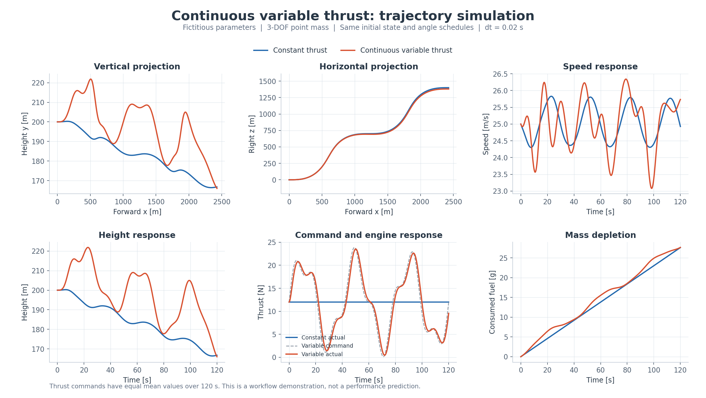
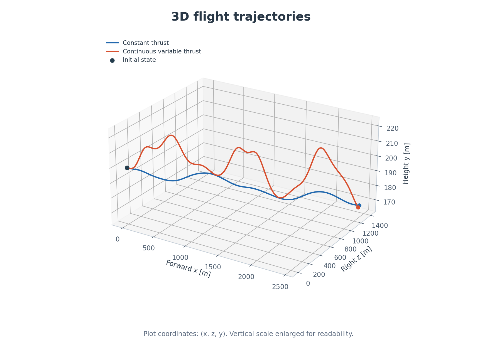

# btt_guidance

连续可变推力三维轨迹仿真教学工程。使用虚构的小型试验飞行器参数，跑通油门指令、推力响应、燃料消耗、气动力、RK4积分及轨迹绘图流程。

- [数学模型与方案](docs/MODEL_zh.md)
- [模型范围与设计约定](docs/DESIGN_zh.md)
- [完整运行说明](README_zh.md)
- [验证记录](docs/VALIDATION_zh.md)
- [C源代码](c/)
- [MATLAB程序](matlab/)



## MATLAB运行

进入 `matlab` 文件夹，在命令窗口执行：

```matlab
results = run_variable_thrust_demo;
```

只查看随仓库交付的C计算结果：

```matlab
plot_saved_csv;
```

## C运行

在仓库根目录使用GCC或MinGW-w64编译：

```sh
gcc -std=c99 -O2 -Wall -Wextra c/main.c c/trajectory.c -lm -o trajectory_demo
./trajectory_demo constant results/constant.csv
./trajectory_demo variable results/variable.csv
```

Windows编译为 `trajectory_demo.exe`，使用 `.\trajectory_demo.exe` 运行。更多CMake和Windows命令见 [运行说明](README_zh.md)。

## 当前版本

v0.1：三自由度质点模型，状态 `[x,y,z,vx,vy,vz,m,T]`；坐标为初始前向x、竖直向上y、初始右向z；零侧滑、给定攻角与倾侧角；动力为一阶推力响应与抽象燃料模型，包含燃料耗尽和触地事件。

C版已在GCC环境运行，含两组120秒、步长0.02秒的完整CSV和PNG结果。MATLAB版按相同方程编写，本次没有MATLAB/Octave运行验证。未使用真实气动数据库，未包含六自由度姿态动力学。


