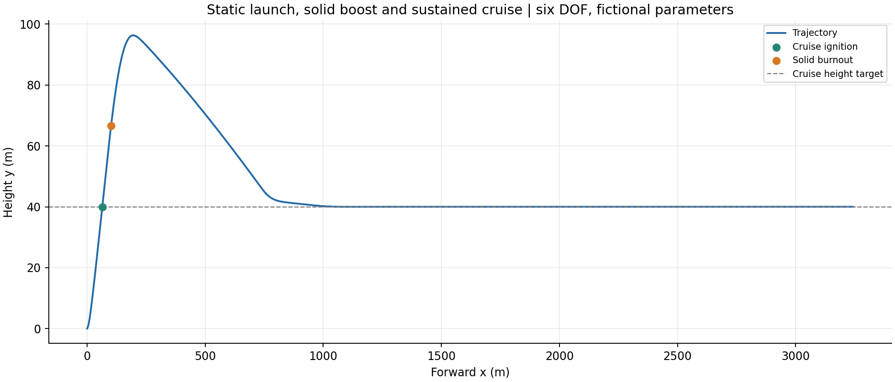
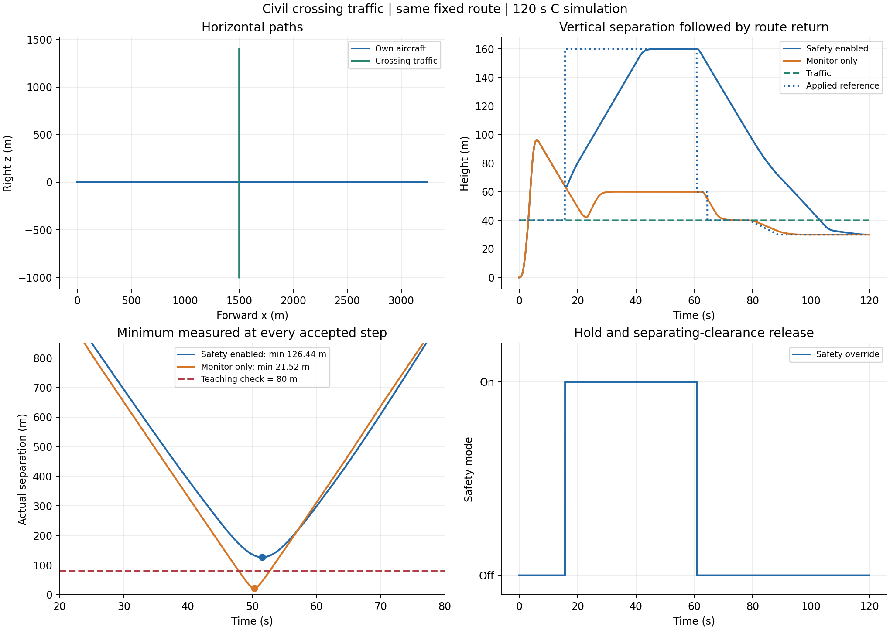

# 连续可变推力轨迹仿真：三自由度与六自由度

这是一个无需真实气动数据的小型试验飞行器教学工程。C版已实际编译并运行；MATLAB版按相同方程编写，无专用工具箱依赖，但本次环境没有MATLAB/Octave，未做MATLAB运行验证。

先看 `results/overview.png` 与 `results/trajectory_3d.png`；详细模型见 `docs/MODEL_zh.md`。

## A. 用MATLAB运行

1. 解压整个工程。
2. 在MATLAB把当前目录切换到工程的 `matlab` 文件夹。
3. 在命令窗口执行：

```matlab
results = run_variable_thrust_demo;
```

程序分别运行恒定推力、连续变推力两组案例，显示两张图并输出CSV和PNG到`matlab` 文件夹下的 `results_matlab`。不会覆盖随包交付的C结果。

修改时长或步长：

```matlab
results = run_variable_thrust_demo('my_results', 0.02, 120);
```

只想查看已运行的C结果，无需重新仿真：

```matlab
plot_saved_csv;
```

MATLAB参数入口在 `run_variable_thrust_demo.m` 的 `default_params` 函数；改变 `throttle_mean/amp/period` 可以改变连续推力指令。`alpha_amp` 与 `bank_amp` 为攻角/倾侧角输入，单位rad。

## B. 用C运行（GCC / MinGW-w64）

在工程根目录执行以下命令。无需外部C库、网络、真实气动文件或Python。

Linux/macOS的GCC或兼容编译器：

```sh
gcc -std=c99 -O2 -Wall -Wextra c/main.c c/trajectory.c -lm -o trajectory_demo
./trajectory_demo constant results/constant.csv
./trajectory_demo variable results/variable.csv
```

Windows的MinGW-w64，在VSCode终端或PowerShell中：

```powershell
gcc -std=c99 -O2 -Wall -Wextra c/main.c c/trajectory.c -lm -o trajectory_demo.exe
.\trajectory_demo.exe constant results/constant.csv
.\trajectory_demo.exe variable results/variable.csv
```

自定义步长和时长（单位s）：

```powershell
.\trajectory_demo.exe variable results/variable.csv 0.01 120
```

CSV的目标目录须已存在。`constant` / `variable` 为合法模式；要求0<dt≤1 s、0<duration≤3600 s，输出步数不超过1000000。本版从已经飞行的状态开始，未建立地面起飞过程。

参数入口为 `c/trajectory.c` 的 `vt_default`，修改后重新编译。

### 可选CMake

```sh
cmake -S . -B build
cmake --build build
ctest --test-dir build --output-on-failure
```

建议使用GCC/MinGW-w64编译器。CMake配置文件已提供，本次环境未安装CMake，实际验证使用上述GCC命令。

## C. C程序如何输出曲线

C版负责积分并输出CSV。可以在MATLAB运行 `plot_saved_csv` 绘图，也可直接查看本包的PNG。可选Python绘图需要numpy与matplotlib：

```sh
python plot_results.py
```

## D. 已生成的示例结果

相同初始速度25 m/s、高度200 m、质量12 kg；120 s、步长0.02 s，每组6001行。

| 指标 | 恒定推力 | 连续变推力 |
|---|---:|---:|
| 末时刻x | 2426.304 m | 2427.282 m |
| 末时刻高度y | 166.750 m | 166.016 m |
| 末时刻z | 1400.124 m | 1380.422 m |
| 最高高度 | 200.279 m | 221.846 m |
| 末速度 | 24.928 m/s | 25.733 m/s |
| 消耗燃料 | 27.600 g | 27.637 g |

这些数字只说明程序已产生不同且有限的轨迹，不代表任何真实飞行器性能。两案例的平均推力指令相同，实际推力积分由于滞后略有区别。

## E. 文件与计算流程

| 文件 | 用途 |
|---|---|
| c/trajectory.h | 参数、状态和函数接口 |
| c/trajectory.c | 动力、气动、运动方程、RK4与事件 |
| c/main.c | 命令行输入、场景运行、CSV输出 |
| matlab/run_variable_thrust_demo.m | 完整MATLAB仿真与绘图 |
| matlab/plot_saved_csv.m | 查看C已计算的CSV |
| plot_results.py | 可选科学绘图脚本 |
| results/*.csv | 已运行的两组时序结果 |
| results/*.png | 二维/三维轨迹和状态曲线 |
| results/verification.json | 数值对照记录 |
| docs/MODEL_zh.md | 数学模型、坐标和假设 |
| docs/VALIDATION_zh.md | 已验证项目及未验证项 |
| tests/check_core.c | 六个解析/边界校核算例 |

流程：初始化→连续油门指令→实际推力与燃料流量→气动力及重力→RK4积分→耗尽/触地事件→CSV→绘图。

## F. 可选校核

只用C编译器即可运行物理检查：

```sh
gcc -std=c99 -O2 -I c tests/check_core.c c/trajectory.c -lm -o check_core
./check_core
```

Windows请生成 `check_core.exe` 并用 `.\check_core.exe` 运行。

独立数值积分对照需要Python、numpy、scipy，不是正常仿真的运行依赖：

```sh
python tests/verify_outputs.py ./trajectory_demo
```

上述 v0.1 三自由度子模块没有姿态积分；新增六自由度子模块见下文。两个教学模型均使用虚构参数。

## G. 新增六自由度仿真

原 `c/`、`matlab/`、`tests/`、`results/` 及三自由度模型文档全部保留。新的 `six_dof/` 包含 C 和 MATLAB 独立实现、解析测试、CSV 与四组曲线。

请从 [六自由度运行说明](six_dof/README_zh.md) 进入，模型见 [MODEL_6DOF_zh.md](docs/MODEL_6DOF_zh.md)，实际验证见 [VALIDATION_6DOF_zh.md](docs/VALIDATION_6DOF_zh.md)。默认采用全力/力矩初始配平、15 维状态、0.01 s RK4 步长和 120 s 时长，两种模式每组 2401 个样本。CSV 角度单位为 rad，图中角度为 deg。

注意：原三自由度和新增六自由度 MATLAB 文件夹各有一个 `plot_saved_csv.m`。使用某个模型时只将对应文件夹加入 MATLAB 路径；切换模型先 `rmpath` 另一个目录，再 `clear plot_saved_csv`。

## H. 固体助推起飞后接管持续巡航

新增 [助推与巡航运行说明](six_dof/boost_cruise/README_zh.md)、[数学模型](docs/MODEL_BOOST_CRUISE_zh.md) 和 [实际验证](docs/VALIDATION_BOOST_CRUISE_zh.md)。本情形从地面静止释放，使用预设固体助推；高度 **40 m** 且速度 **25 m/s** 同时达到后点火巡航动力。助推仍在 **4 s** 自然燃尽，允许两种动力短时重叠，之后简易稳定器维持巡航。

已实际运行 C 的 120 s 案例：巡航点火 **3.114496 s**，末高度 **40.0076 m**、末速度 **24.9965 m/s**。助推造成最高约 **96.32 m** 的高度超调，再逐渐回到巡航目标。全部参数为虚构教学值；MATLAB 独立源码已提供，当前环境未执行。原三自由度与原六自由度案例保留。



## I. 民用航路跟踪与独立交通避碰

[运行与控制器接口说明](six_dof/civil_route/README_zh.md) 提供新情形：保留固体助推—巡航动力切换，跟踪固定低空航路，出发、航路、进近三个阶段可分别选择或传入控制器回调。交通信息由独立安全监督器处理。

实际 C 仿真包括 10 km 恒高交通、低空交叉避碰及仅监测对照；交叉情形最小三维间距分别为 **126.44 m**（开启监督）与 **21.52 m**（仅监测）。本机仍使用现有虚构小型飞行器参数和低空航路。完整模型见 [MODEL_CIVIL_ROUTE_zh.md](docs/MODEL_CIVIL_ROUTE_zh.md)，校核见 [VALIDATION_CIVIL_ROUTE_zh.md](docs/VALIDATION_CIVIL_ROUTE_zh.md)。C 已实际运行；新 MATLAB 入口调用 C 并绘制 CSV，当前未执行 MATLAB。


