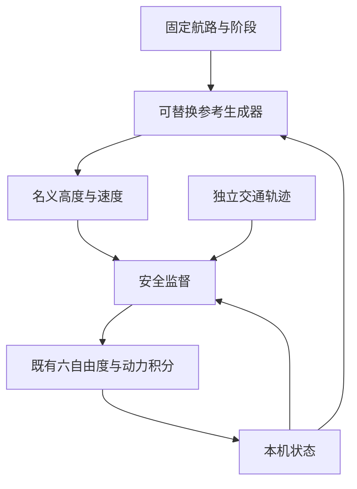

# 民用固定航路与独立交通模型

本扩展复用 [助推六自由度模型](MODEL_BOOST_CRUISE_zh.md)。本机内部仍使用 NED、右手機体坐标、四元数以及独立助推/巡航库存，共 17 维连续状态；输出映射为前向 $x=N$、高度 $h=-D$、右向 $z=E$。力、力矩、发动机一阶响应、AND 点火门限和自然燃尽不变。

新增模块处理固定民用航路、三个阶段参考生成器，以及独立交通安全监督。航路先采用纵向高度/速度参考、横向对称假设。全部六自由度仍被积分，默认滚转、偏航和横向位移保持零。没有地面接触、着陆或复杂交通协调模型。

## 控制器与动力接口

每个阶段有一个 `CivilController` 函数指针。其只读输入为本机状态、当前固定航路点、该段进入时刻和参考；输出高度/速度参考。内置 `launch` 固定 40 m/25 m/s；`direct` 使用航路段给定值；`slew` 使用

$$h_r=h_0+\operatorname{clip}(h_g-h_0,-(t-t_0),t-t_0),$$
$$V_r=V_0+\operatorname{clip}(V_g-V_0,-0.5(t-t_0),0.5(t-t_0)).$$

阶段和航路段切换时，从上一条已发参考保存 $h_0,V_0,t_0$，不重置连续运动状态。所有回调必须无副作用，非法返回/参考立即失败；模型范围为高度 1–300 m、速度 15–40 m/s。

控制器参考经安全监督后输入原 BC 稳定器。按当前质量、参考高度/速度求一个独立的水平飞行配平，用于更新参考迎角及舵面/油门配平值；求解中的虚拟初始状态不覆盖真实飞行状态。高度/速度跟踪、俯仰反馈和舵面限幅沿用原 BC 模型。这一回调层替换的是参考生成器，内层反馈稳定器仍为既有实现。

## 固定航路与阶段

| 段 | 通过前向坐标 x | 高度参考 | 速度参考 |
|---:|---:|---:|---:|
| 0 | 800 m | 40 m | 25 m/s |
| 1 | 1800 m | 60 m | 25 m/s |
| 2 | 2200 m | 40 m | 25 m/s |
| 3 | 2800 m | 30 m | 20 m/s |

依次通过各前向坐标平面后推进航路段。出发阶段在 $t\ge8$ s、巡航已点火及固体已燃尽后结束；进入最后一段时为进近阶段。`route_complete` 仅指通过最终前向坐标平面，高度、速度和横向误差由各字段记录。逻辑切换按接受步检测，分辨率为 dt；动力事件仍由原 BC 子步定位。

## 独立交通及最近接近预测

交通使用解析匀速模型：

$$\mathbf r_t(t)=\mathbf r_{t0}+t\mathbf v_t.$$

`high` 的初态为 $(6000,10000,0)$ m、速度 $(-50,0,0)$ m/s；`crossing/monitor` 初态为 $(1500,40,-1000)$ m、速度 $(0,0,20)$ m/s。交通的运动不读取或响应本机控制器。

设水平相对位置 $\mathbf d=[x_t-x,z_t-z]^T$、水平相对速度 $\mathbf u=[v_{xt}-v_x,v_{zt}-v_z]^T$。对常速度预测 $\|\mathbf d+\tau\mathbf u\|^2$ 求最小值得

$$\tau_*=\operatorname{clip}\left(-\frac{\mathbf d^T\mathbf u}{\mathbf u^T\mathbf u},0,L\right),\qquad
d_{H*}=\|\mathbf d+\tau_*\mathbf u\|,$$

其中 $L=30$ s。当相对速度平方≤$10^{-16}$ 时使用 $\tau_*=0$。当前真实三维间距按

$$d=\sqrt{(x_t-x)^2+(h_t-h)^2+(z_t-z)^2}$$

计算；当前高度差取绝对值。两机正在水平接近的条件为 $\mathbf d^T\mathbf u<0$。这只是用于交通风险筛查的常速度预测，不能代替实际动力学验证。

## 安全监督

默认交叉情形启用监督。巡航已点火、助推已燃尽后，若水平接近、$d_{H*}<120$ m 且当前高度差<100 m，锁存安全模式。实际高度参考设为

$$h_{\mathrm{cmd}}=\max(h_r,h_t+120\ \mathrm m),\qquad V_{\mathrm{cmd}}=V_r.$$

安全模式至少保持 40 s，随后只有水平间距>300 m且 $\mathbf d^T\mathbf u>0$（水平间距正在增大）时才释放。相对静止时保持覆盖。锁存的高度参考保证保持期间不会因短暂预测变化反复启停。`monitor` 不施加参考覆盖，仅保存实际及预测间距；`high` 为高空交通观测情形。

所有阈值均为教学输入。默认交叉案例以实际最小三维间距≥80 m验收；不推断任意交通速度/轨迹、响应延迟、风或传感器误差下的安全保证。当前交通状态为理想已知真值。

## 输出与数值统计

默认120 s、RK4 dt=0.005 s，每10个常规步输出，并保留动力/逻辑事件行。流式输出只缓存一行，相同时间事件合并，极短正时长仍有初末样本。每个接受步用解析交通位置统计最小间距、最大四元数误差，JSON 记录极值、发生时间及控制器调用次数；逐步统计仍是有限 dt 的离散检查。

CSV `route_height_m/route_speed_mps` 是当前控制器生成的名义参考，`command_height_m/command_speed_mps` 是安全监督后的参考。`altitude_error_m` 相对于名义参考，因此避碰期间可能故意变大。动力字段与姿态字段来自原 BC 观察函数，角度为 rad。

MATLAB 新前端调用相同 C 实现，绘图函数直接读取 CSV；当前未提供新场景的第二套独立 MATLAB 动力学。原教学案例的 MATLAB 实现保持。
