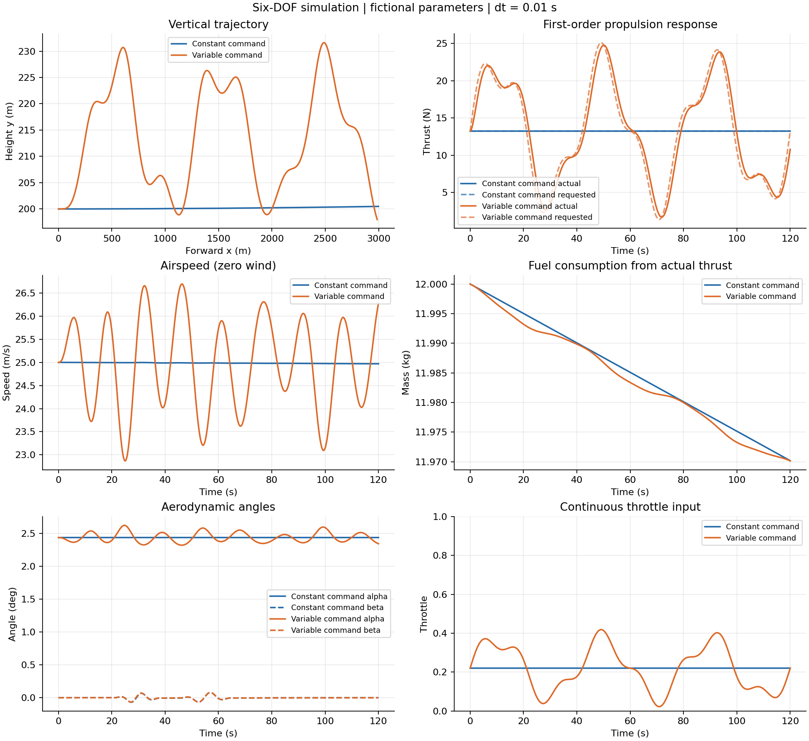

# 六自由度持续可变动力仿真

在原三自由度示例之外，新增 15 维状态的刚体仿真：三轴平移、机体角速度、四元数、耗油质量及实际推力。采用虚构参数、小舵面扰动和连续油门输入，先把建模到曲线输出的流程跑通。

详细方程见 [MODEL_6DOF_zh.md](../docs/MODEL_6DOF_zh.md)，验证记录见 [VALIDATION_6DOF_zh.md](../docs/VALIDATION_6DOF_zh.md)。

## C 运行

以下命令在仓库根目录执行，需要 C99 编译器。

```sh
mkdir -p build
gcc -std=c99 -O2 -Wall -Wextra -Werror -Isix_dof/c six_dof/c/main.c six_dof/c/six_dof.c -lm -o build/six_dof_demo
./build/six_dof_demo constant six_dof/results/constant.csv 120 0.01 5
./build/six_dof_demo variable six_dof/results/variable.csv 120 0.01 5
python six_dof/plot_results.py
```

CSV 输出目录必须存在。参数顺序为模式、CSV 文件、时长、步长、输出步数间隔；后三项可省略，默认 120 s、0.01 s、5。无效输入或数值失败时返回非零状态码。

CMake 提供独立 `six_dof_demo`、`check_six_dof_core` 和 `check_six_dof_events` 目标；原目标仍保留。可使用 `cmake -S . -B build`、`cmake --build build`、`ctest --test-dir build`。本次环境未安装 CMake，实际执行使用上面的 GCC 路径。

## MATLAB 运行

```matlab
addpath('six_dof/matlab');
summary = run_six_dof_demo();
% 可选：run_six_dof_demo('six_dof/results_matlab',120,0.01,5);
% 直接绘制已保存的 C 结果：
plot_saved_csv('six_dof/results');
```

MATLAB 程序包含独立的全配平、刚体方程、四元数、RK4 和事件定位，使用基础函数。默认输出到 `six_dof/results_matlab/`，生成两份 CSV、四组 PNG 以及 `summary.mat`。本次环境没有 MATLAB/Octave，尚未实际执行 MATLAB 版本；已附曲线由实际运行的 C 结果生成。

## 验证与结果

```sh
python six_dof/tests/run_checks.py all
python six_dof/tests/verify_outputs.py
# 重新生成默认 C 结果和验证摘要：
python six_dof/tests/verify_outputs.py --generate
python six_dof/plot_results.py
# 原三自由度物理检查：
python tests/run_checks.py
```

输出检查需要 NumPy，绘图需要 Matplotlib。解析检查仅需要 Python 标准库及 GCC。

- `results/constant.csv`、`variable.csv`：默认 120 s，分别 2401 个样本，所有 CSV 角度为 rad。
- `results/verification.json`：参数、初始配平、终止原因、范围及 0.01/0.005 s 步长比较。
- `results/trajectory_3d.png`：三维轨迹；坐标轴顺序为 x 前、z 右、y 高度。
- `results/overview.png`：高度轨迹、实际/指令推力、速度、质量、迎角/侧滑角及油门。
- `results/attitude_rates.png`、`controls.png`：姿态/角速度及舵面输入。

恒定模式表示恒定油门指令；持续可变模式有发动机响应滞后。两案例使用同一初始全配平状态和小舵面输入。六自由度中的迎角、侧滑角及姿态由状态演化，与原三自由度的预设角度模型不同，不能通过曲线重合来判断哪个更准确。虚构参数结果只用于验证本教学方程和程序流程。


