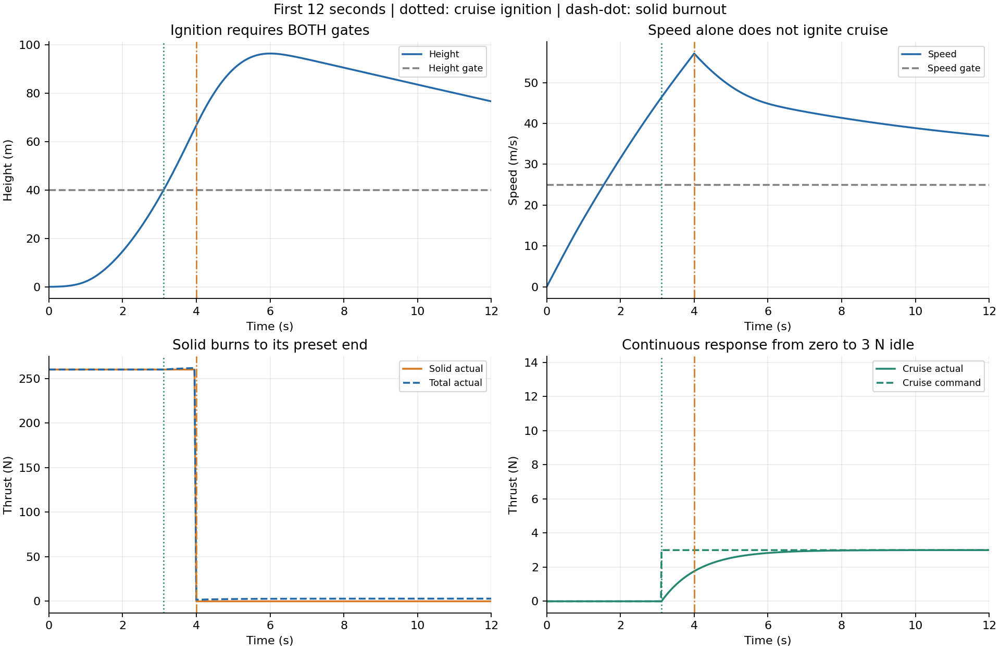

# 地面静止释放、固体助推与持续巡航

新增六自由度情形：固体助推器从地面静止释放开始工作，当高度与速度同时达到门限，点火可变推力巡航动力；固体助推仍按预设时间自然燃尽。两种动力可短时重叠，之后巡航稳定器调节推力及俯仰。原三自由度和原六自由度案例均保留。

本示例使用虚构民用小型试验飞行器参数，目的是跑通数学模型、事件交接、积分、CSV 和曲线流程。完整方程见 [MODEL_BOOST_CRUISE_zh.md](../../docs/MODEL_BOOST_CRUISE_zh.md)，实测校核见 [VALIDATION_BOOST_CRUISE_zh.md](../../docs/VALIDATION_BOOST_CRUISE_zh.md)。

## C 运行

在仓库根目录执行，需 GCC 或兼容 C99 编译器及 libm，无其他仿真依赖。

```sh
mkdir -p build
gcc -std=c99 -O2 -Wall -Wextra -Werror -Isix_dof/c -Isix_dof/boost_cruise/c six_dof/boost_cruise/c/main.c six_dof/boost_cruise/c/boost_cruise.c six_dof/c/six_dof.c -lm -o build/boost_cruise_demo
./build/boost_cruise_demo six_dof/boost_cruise/results/boost_cruise.csv 120 0.005 10
python six_dof/boost_cruise/plot_results.py
```

CSV 输出目录必须已存在。CLI 参数为输出文件、时长、步长、输出步数间隔；后三项可省略，默认 `120 0.005 10`。要求有限正数，时长不超过 3600 s、积分步数不超过 2000000；输出间隔为正整数。数值失败返回非零值，请使用小步长。物理参数在 `c/boost_cruise.c` 的 `bc_default`，修改后重新编译。

CMake 另提供 `boost_cruise_demo`、`check_boost_cruise_model` 目标，原目标仍保留。本次未安装 CMake，已实际验证以上 GCC 路径。

## MATLAB 运行

```matlab
addpath('six_dof/boost_cruise/matlab');
summary = run_boost_cruise_demo();
% 可选自定义输出目录、时长、步长、输出间隔：
% summary = run_boost_cruise_demo('my_boost_results',120,0.005,10);
% 直接绘制交付的 C CSV：
plot_saved_boost_cruise('six_dof/boost_cruise/results');
```

使用基础 MATLAB 函数，不依赖专用工具箱；默认保存到 `results_matlab/`。`run_boost_cruise_demo.m` 的 `defaults` 是物理参数入口。MATLAB 独立实现相同的 17 维方程、固定模式 RK4、事件定位及 CSV 字段；**本次环境无 MATLAB/Octave，尚未执行 MATLAB 仿真或作数值对照**。交付图由实际 C CSV 经 Python 绘制。

## 默认参数与交接

| 项目 | 虚构默认值 |
|---|---:|
| 初始高度 / 速度 / 俯仰 | 0 m / 0 m/s / 35° |
| 干质量 / 助推推进剂 / 巡航燃料 | 11.7 / 0.5 / 0.3 kg |
| 固体净推力 / 燃烧时间 | 260 N / 4 s |
| 巡航点火门限 | 高度 ≥40 m **且**速度 ≥25 m/s |
| 巡航高度 / 速度目标 | 40 m / 25 m/s |
| 巡航怠速 / 最大推力 / 响应常数 | 3 N / 60 N / 1 s |
| 俯仰指令交接时间 | 3 s |
| 积分 / 常规输出间隔 | 0.005 s / 0.05 s |

点火锁存一次，后续下降到门限以下不关闭巡航。点火当刻巡航实际推力为零，其后连续建立；固体推力不随巡航油门提前关断。助推燃尽及点火都保持运动状态连续，壳体保留，不模拟抛离。起飞是具有向上初始加速度的自由释放，不含轮胎、导轨或地面接触反力。

默认实际结果：**3.114496 s** 巡航点火，当刻高度 40 m、速度 46.4172 m/s；**4 s** 固体燃尽，当刻高度 66.6807 m、速度 57.1277 m/s。最高高度 **96.3202 m**，随后回到巡航目标；120 s 末高度 **40.0076 m**、速度 **24.9965 m/s**、前向距离 **3244.355 m**。门限是点火条件，不能阻止助推继续燃烧带来的超调。

## 校核与输出

```sh
python six_dof/boost_cruise/tests/run_checks.py
python six_dof/boost_cruise/tests/verify_outputs.py
python six_dof/boost_cruise/tests/check_preservation.py
# 重新生成本情形 C CSV、摘要与图：
python six_dof/boost_cruise/tests/verify_outputs.py --generate
python six_dof/boost_cruise/plot_results.py
# 旧六自由度及原三自由度回归：
python six_dof/tests/run_checks.py all
python six_dof/tests/verify_outputs.py
python six_dof/tests/check_regression.py
```

解析/CLI 检查只需 Python 标准库及 GCC；输出验证需 NumPy，绘图需 Matplotlib。旧三自由度独立对照另需 SciPy。

| 文件 | 用途 |
|---|---|
| `c/boost_cruise.h`, `c/boost_cruise.c` | 两类库存、动力/稳定器、最早事件推进接口 |
| `c/main.c` | CLI 与 58 列 CSV |
| `matlab/run_boost_cruise_demo.m` | 独立 MATLAB 仿真 |
| `matlab/plot_saved_boost_cruise.m` | MATLAB 绘制 C 或 MATLAB CSV |
| `results/boost_cruise.csv` | 120 s 的 2402 行实际 C 结果 |
| `results/verification.json` | 事件、终态、范数及半步长实测摘要 |
| `results/trajectory.png`, `overview.png` | 轨迹与全程状态 |
| `results/handoff.png`, `attitude.png` | 前 12 s 动力交接、姿态与角速度 |

CSV 前 41 列沿用原六自由度格式；`thrust_N` 与 `thrust_cmd_N` 指巡航实际/指令推力，`boost_thrust_N` 指固体推力，`total_thrust_N` 为两者实际之和。所有 CSV 角度为 rad。`stage` 为 0 助推、1 动力重叠、2 无动力滑行、3 巡航、4 巡航耗尽；`event_mask` 位为 1 点火、2 固体燃尽、4 巡航燃料耗尽、8 触地。输出为事件处理后的状态，额外保留事件行，同时间只保留一行。



